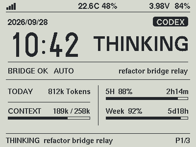
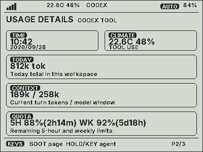
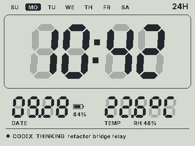
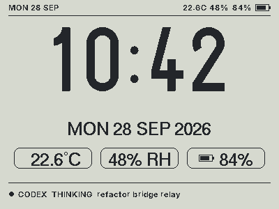
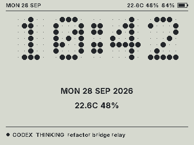
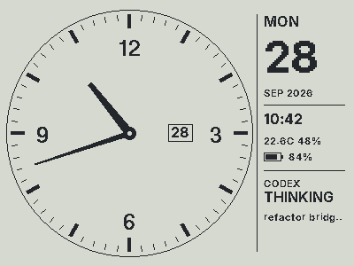
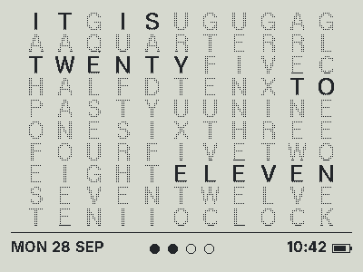
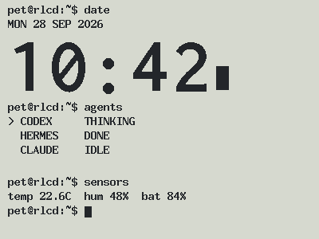
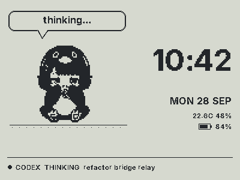
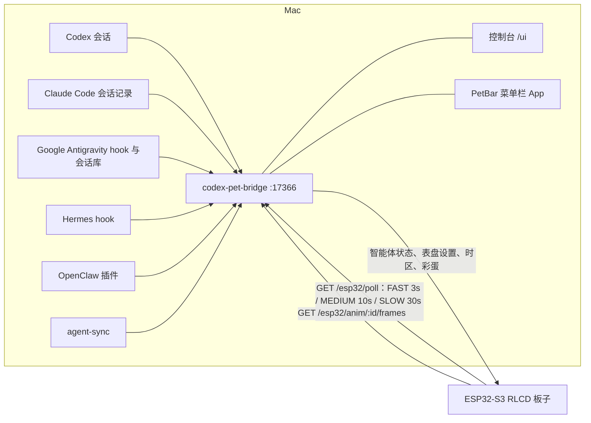

# waveshare-rlcd-agent-pet

[English](README.en.md) · 中文

一块放在桌上的反射式屏幕（Waveshare `ESP32-S3-RLCD-4.2`），用来显示你的编程智能体在做什么：Codex、Claude Code、Google Antigravity、Hermes、OpenClaw。它同时是一块时钟，显示电量和室内温湿度，还藏了一个能播放 1-bit 视频的彩蛋。Mac 上有一个小小的 bridge 负责收集状态，另有网页控制台和菜单栏 App 用来查看和控制。

这是基于 [xyuuii/waveshare-rlcd-agent-pet](https://github.com/xyuuii/waveshare-rlcd-agent-pet) 的个人 fork。我们希望它在屏幕常亮、Wi-Fi 保持连接的情况下，文字更易读，同时尽量降低耗电；原项目的 bridge 和交互能力仍是这个版本的基础。

## 这个版本做了什么

- 重新调整概览、用量和时钟三个页面，使用多种预先准备的点阵字号，包括由 Inter 生成的字形，让英文信息更易读。
- 概览页采用上下分舞台与无边框双栏布局：上半区融合大号时间（`50pt`）、7 级字号自适应粗体状态字、深色智能体来源胶囊与当前模型信息；下半区左栏展示今日 Token 与上下文进度条，右栏堆叠展示 5 小时与每周额度进度条及重置倒计时。常态页面取消秒显示，需要时仍可主动播放彩蛋。
- 新增 **Google Antigravity** 全链路接入：自动配置生命周期 Hook，读取本地会话记录计算今日非缓存 Token 与上下文窗口，并后台查询 `agy` 模型额度与重置倒计时。
- 概览页顶栏显示竖条 Wi-Fi 信号、动态居中的室内温湿度，以及电池电压和按 3.60–4.10 V 工作区间估算的电量。低电压持续确认后进入定时唤醒的深睡眠保护。
- 通过单独重编的 Arduino-ESP32 2.0.17 / ESP-IDF 4.4.7 SDK 启用自动轻睡眠和动态调频（`80 MHz` 上限 / `20 MHz` 空闲下限）。Wi-Fi 保持连接，非动画传输时使用最大无线省电模式（`WIFI_PS_MAX_MODEM`，`listen_interval = 10`）。
- 新增 **四级自适应睡眠节拍状态机（`FAST` / `MEDIUM` / `SLOW` / `DEEP`）** 与底栏右侧状态提示：活跃时 `3s`、空闲 1–10 分钟 `10s`、10–30 分钟 `30s`、超过 30 分钟无状态变化自动进入 `120s` 深度省电轮询（并支持按任意侧键一键唤醒回 `FAST`）；同时关断板载闲置功放与音频芯片、启用 ST7305 硬件低功耗模式（LPM `0x39`）、HTTP Keep-Alive 长连接复用与分钟级对齐 RTC 采样。

## 省电优化全览

为了在“保持 Wi-Fi 在线、分钟级时钟走字、侧键随时响应”的前提下尽可能延长电池续航，本版本从 **CPU 与电源管理、网络与四级睡眠节拍、反射屏硬件与渲染去重、板载闲置外设关断、传感器采样与死区过滤、低电量深睡保护** 六个维度做了系统性优化：

### 1. CPU 动态调频（DFS）与 Tickless 自动轻睡眠
- **80 MHz / 20 MHz 动态调频 + Automatic Light Sleep**：基于定制编译的 ESP-IDF 4.4.7 PM SDK（启用 `CONFIG_PM_ENABLE` 与 `CONFIG_FREERTOS_USE_TICKLESS_IDLE`），常态运行上限锁定为 `80 MHz`（相比默认 `240 MHz` 大幅降低动态电流），非睡眠空闲下限下探至 `20 MHz`（`XTAL/2`）。开机 45 秒烧录窗口结束后自动挂起 Light Sleep，空闲期间自动关闭 CPU 时钟、480 MHz BBPLL 锁相环与内部 USB-Serial/JTAG PHY。
- **纯事件驱动网络任务（消除 10 Hz 空转唤醒）**：Core 0 上的 `netTask` 摒弃传统的 `100ms` 轮询，改用 `ulTaskNotifyTake` 精确阻塞至下一次轮询或重连时刻；当侧键切换焦点、唤醒或启动彩蛋流时，Core 1 通过 `xTaskNotifyGive` 实现 `0ms` 零延迟唤醒。
- **主循环空闲降频与串口静默**：无按键按下时主循环步进放宽至 `200ms`（GPIO 低电平唤醒保证首次按键不丢，按下期间自动切回 `50ms` 保证长按/组合键手感）；进入自动轻睡眠后自动静默周期性 `[BRIDGE] ok` 与 `[WIFI] ok` 串口输出。

### 2. 四级自适应睡眠节拍（`FAST` / `MEDIUM` / `SLOW` / `DEEP`）与网络省电
针对桌面电脑常年不关机的场景，根据智能体状态变化时长动态调节轮询与采样频率，并在概览页与用量页底栏最右侧实时显示当前节拍档位：

| 档位（底栏右端显示） | 触发条件 | Bridge 轮询周期 | 传感器采样周期 | 说明 |
| :--- | :--- | :--- | :--- | :--- |
| **`FAST`** | Agent 工作中（`Running` / `NeedsAttention`）、刚开机、按键唤醒或状态变化 $\le 1$ 分钟 | **3 秒** | 电池 5s / 温湿度 30s | 实时跟随智能体思考与工具调用状态 |
| **`MEDIUM`** | Agent 状态连续 **1 ~ 10 分钟** 未变化 | **10 秒** | 电池 5s / 温湿度 30s | 被动额度倒计时与滑动窗口恢复、SQLite 后台 WAL 检查点、Wi-Fi 瞬时重连均不打断空闲计时 |
| **`SLOW`** | Agent 状态连续 **10 ~ 30 分钟** 未变化 | **30 秒** | 电池 5s / 温湿度 30s | 中度空闲，射频唤醒频率再降 66% |
| **`DEEP`** | Agent 状态连续 **超过 30 分钟** 未变化 | **120 秒** | **电池 30s / 温湿度 120s** | 深度省电；按任意侧键首次立即唤醒回 `FAST`（不误翻页），轮询发现 Agent 工作也立即切回 `FAST` |

- **Wi-Fi 最大调制解调器睡眠 + Beacon 间隔拉长**：常态启用 `WIFI_PS_MAX_MODEM` 并将 `listen_interval` 设为 `10`（约 1 秒唤醒收听一次路由器 Beacon），仅在彩蛋视频流下载期间临时切换为 `WIFI_PS_NONE`。
- **HTTP Keep-Alive 长连接复用**：固件端复用持久化 `WiFiClient` + `HTTPClient::setReuse(true)`，配合 Mac Bridge 的 30 秒 `keepAliveTimeout` 与显式 `Content-Length`，省去每次轮询的 TCP 三次握手与四次挥手，缩短射频高功耗 TX/RX 窗口。
- **零日常开销的按需 mDNS 自动寻址 + NVS IP 缓存**：平常直接连接缓存的 IPv4 地址（不开启后台 mDNS 监听、不消耗额外电量）；当 Mac 重启或路由器重分配 DHCP 导致连续 2 次轮询超时时，固件自动临时唤醒单次 mDNS 查询（`<LocalHostName>.local`），解析到新 IP 后立即恢复连接并写入 NVS 闪存持久化。
- **Wi-Fi 断线指数退避**：路由器关闭或外出断网时，重连间隔按 `10s -> 20s -> 40s -> 60s -> 120s` 指数退避，避免持续高耗电全信道扫描；按任意侧键可立即重置退避并触发重连。

### 3. ST7305 反射屏硬件低功耗模式与帧哈希去重
- **ST7305 硬件 Low Power Mode（`0x39`）**：初始化默认发送 `0x39` 指令启用面板内部低功耗刷新与电荷泵模式（静态画面零视觉差异），仅在播放彩蛋动画期间临时切回 `0x38` 高帧率模式。
- **15 KB 帧缓冲 FNV-1a 哈希去重**：每次渲染后计算 15 KB 显存哈希，若像素与上一帧完全一致则跳过 SPI 传输；兜底重绘检查周期放宽至 `60s`。

### 4. 板载闲置音频与功放硬件关断
- Waveshare `ESP32-S3-RLCD-4.2` 板载了立体声编解码器 `ES8311`（`0x18`）、四路麦克风 ADC `ES7210`（`0x40`）以及模拟功放芯片。固件在启动时显式将功放使能脚 `PA_CTRL`（`GPIO 46`）置为 `OUTPUT LOW` 并调用 `gpio_hold_en` 跨睡眠锁定，同时通过 I2C 向 `ES8311` 与 `ES7210` 写入 Deep Power-Down 寄存器指令，彻底消除闲置音频链路漏电。

### 5. 传感器按需唤醒与显示死区过滤
- **RTC 按整分对齐读取（减少 96% I2C 唤醒）**：所有常态页面均不显示秒，[`nextClockSampleDelayMs()`](firmware/agent_pet_display/src/poll_policy.cpp) 根据当前秒数动态休眠至下一分钟的第 58 秒再唤醒读取 `PCF85063`，将 I2C 锁（`ESP_PM_APB_FREQ_MAX`）触发次数从每分钟 60 次降至 2 次。
- **SHTC3 测完即睡 + 温湿度/电池显示死区**：`SHTC3` 每次采样后立即发送 `0xB098` 进入硬件休眠；显示层对电池电压施加 `20 mV` 死区、对温湿度施加 `0.1°C` / `1%` 死区，防止传感器底噪引发整屏重绘。

### 6. 低电量定时深睡眠保护（Deep Sleep）
- 当连续 10 次有效采样电池电压低于 `3.60 V` 时，先关闭 Wi-Fi 射频、在屏幕绘制低电量提示并锁定 LCD 引脚电平（`gpio_hold_en`），随后进入 `esp_deep_sleep`（每次休眠 600 秒后快速唤醒检测一次电压，跳过常规启动等待），直到充电恢复至 $\ge 3.75\text{ V}$ 才恢复正常运行。

### 一次实机电流观察

断开电池，用独立 USB 充电器或充电宝供电，在一块板子上通过数字 USB 电流表观察：当前版本多数时候显示 **15–18 mA**，偶尔显示 **30–40 mA**；上一版本多数时候为 **20–23 mA**。

这些是电流表的显示读数，不是仪器记录的长期平均值或真实峰值。路由器、Wi-Fi 信号、工作状态、供电和电流表都会影响结果；USB 输入电流也不能直接当作电池电流推算续航。启动后前 45 秒保留调试窗口，之后才尝试自动轻睡眠。

**构建须知：**上述低功耗版本依赖单独重编的 PM SDK，该 SDK 二进制没有放进仓库。普通 `waveshare_rlcd` 环境可使用官方 SDK 编译，但不会获得相同的自动轻睡眠效果。复现前请先看 [PM SDK 说明](firmware/agent_pet_display/tools/pm-libs/README.md)。

<table>
  <tr>
    <td></td>
    <td></td>
    <td></td>
  </tr>
  <tr>
    <td align="center">概览</td>
    <td align="center">用量</td>
    <td align="center">时钟</td>
  </tr>
</table>

本页的屏幕图是用固件绘图代码生成的电脑预览（见[不接硬件也能看效果](#不接硬件也能看效果)），部分图片可能早于最近一次布局调整；反射屏的实际观感也会不同。

## 板子上显示什么

- **概览**：上半区主舞台融合大号时钟、哪个智能体在活动及其当前状态（思考、调用工具、搜索、等你处理、完成）、bridge 状态与当前模型；下半区双栏展示今日 Token、上下文窗口进度条，以及 5 小时 / 每周额度进度条与重置倒计时；顶栏显示 Wi-Fi 信号、居中温湿度、电压与电量。
- **用量**：Codex 与 Google Antigravity 的今日 Token、上下文窗口、5 小时 / 每周额度及重置倒计时；Claude Code 的今日 Token、上下文和模型。
- **时钟**：七种表盘的全屏时钟，附带日期、室内温湿度和智能体状态。时间来自板载 RTC（按 UTC 保存），时区和夏令时规则跟随 Mac。

<table>
  <tr>
    <td></td>
    <td></td>
    <td></td>
    <td></td>
  </tr>
  <tr>
    <td align="center">大字</td>
    <td align="center">七段数码</td>
    <td align="center">点阵</td>
    <td align="center">指针表盘</td>
  </tr>
  <tr>
    <td></td>
    <td></td>
    <td></td>
    <td></td>
  </tr>
  <tr>
    <td align="center">英文字钟</td>
    <td align="center">终端</td>
    <td align="center">宠物</td>
    <td align="center">内置彩蛋</td>
  </tr>
</table>

## Mac 端

- **Bridge**（`bridge/codex-pet-bridge`）：收集智能体状态，也是板子的数据来源。它跟踪 Codex 会话，读取 Claude Code 的会话记录（无需修改 Claude 的配置），接收 Google Antigravity hook 并读取其本地会话记录与 `agy` 额度，接收 Hermes hook 和 OpenClaw 插件的事件，其余情况交给 `agent-sync`。以两个开机启动项（LaunchAgent）的形式运行。
- **控制台** `http://127.0.0.1:17366/ui/`：智能体状态、板子遥测、表盘选择、时区和彩蛋工坊。
- **PetBar 菜单栏 App**：一眼看到同样的状态。在菜单里可以切换板子页面和表盘、播放彩蛋、打开控制台、重启 bridge。


### 彩蛋

在控制台的「彩蛋工坊」里拖入一个本地视频，比如你自己的 *Bad Apple!!*。浏览器会把它转成 1-bit 帧，可选阈值或抖动、10–30 fps、铺满或半尺寸。视频自带的黑边（比如 16:9 文件里的 4:3 画面）会被自动找到并裁掉，画面可以选填满屏幕或保留完整。只有这些黑白帧会上传到你 Mac 上的 bridge，视频本身不会离开浏览器。点播放后，板子以 16 KB 为一块流式下载帧，并和 Mac 按同一个时间表播放，所以 Mac 可以同步放出视频原声。在板子上同时按住 BOOT 和 KEY 2 秒，会播放默认动画；没有上传动画时播放内置彩蛋。


## 各部分怎么连在一起



板子带着令牌轮询 bridge，每次都附上电量、温湿度、Wi-Fi 信号、当前页面和固件版本。bridge 的回复里除了智能体状态，还有表盘设置、时区和彩蛋指令。网络请求由第二个核心的 FreeRTOS 任务处理，避免慢网络阻塞屏幕主循环。

## 快速开始（Mac）

想让智能体代为安装，可参考 [docs/AGENT_INSTALL.md](docs/AGENT_INSTALL.md)；它介绍的是基础项目，低功耗 SDK 还需额外准备。手动安装：

```bash
git clone https://github.com/jlcbk/waveshare-rlcd-agent-pet.git
cd waveshare-rlcd-agent-pet

# 1. 以开机启动项安装 bridge：第一次只显示计划，加 --apply 才执行
bridge/codex-pet-bridge/tools/mac/install.sh
bridge/codex-pet-bridge/tools/mac/install.sh --apply

# 2. 板子配置（git 忽略）：询问 Wi-Fi 名称和密码，
#    用这台 Mac 的局域网地址和 bridge 令牌拼出 bridge 地址
cd firmware/agent_pet_display
tools/make-secrets.sh

# 3. 先在当前终端按 tools/pm-libs/README.md 准备 PM SDK 和 RLCD_PIO_PACKAGES。
#    用 pio device list 找到 VID:PID 303A:1001 的实际端口并替换下面的示例。
: "${RLCD_PIO_PACKAGES:?请先准备隔离的 PM 工具包}"
PLATFORMIO_PACKAGES_DIR="$RLCD_PIO_PACKAGES" pio run -e waveshare_rlcd_pm -t upload --upload-port /dev/cu.usbmodem101

# 4. 菜单栏 App
../../bridge/codex-pet-bridge/macos/PetBar/build.sh --install
```

`tools/make-secrets.sh` 会自动写入当前局域网 IP 和 Mac 的 Bonjour 主机名（`kBridgeMdnsHost`）；后续即使 Mac 重启后局域网 IP 变化，板子也会通过按需 mDNS 自动发现新 IP 并缓存进 NVS。如果旧的代码目录里 `include/app_config.h` 还写着真实配置，可以用 `tools/import-legacy-secrets.sh <旧的 app_config.h>` 代替第 2 步，把值搬进 `secrets.h`。

bridge 在任何装有 Node 20 的机器上都能跑：`node bridge/codex-pet-bridge/src/bridge-server.js` 默认只监听 `127.0.0.1`，不需要令牌。要在局域网里用，请看 [bridge/codex-pet-bridge/docs/SECURITY.md](bridge/codex-pet-bridge/docs/SECURITY.md)。

## 按键

| 按键 | 操作 | 概览 / 用量页 | 时钟页 |
| --- | --- | --- | --- |
| BOOT | 短按 | 下一页（概览 → 用量 → 时钟） | 下一页 |
| BOOT | 按住 1.5 秒 | 切换跟随的智能体 | 下一个表盘 |
| KEY | 短按或按住 1.5 秒 | 切换跟随的智能体 | 下一个表盘 |
| BOOT + KEY | 一起按住 2 秒 | 彩蛋 | 彩蛋 |
| BOOT | 按住 5 秒 | 彩蛋 | 彩蛋 |
| 任意键 | 彩蛋播放中 | 停止 | 停止 |

表盘和 12/24 小时制可以在控制台或 PetBar 里设置，重启后保留。本 fork 的常态时钟页面不显示秒。

## 目录结构

| 路径 | 内容 |
| --- | --- |
| `firmware/agent_pet_display/` | PlatformIO 固件：各页面、表盘、宠物状态机、网络任务、彩蛋播放 |
| `firmware/agent_pet_display/tools/` | `make-secrets.sh`、`import-legacy-secrets.sh`、`native_tests.sh`、`host_render/` |
| `bridge/codex-pet-bridge/` | bridge（[README](bridge/codex-pet-bridge/README.md) · [中文](bridge/codex-pet-bridge/README.zh-CN.md)） |
| `bridge/codex-pet-bridge/ui/` | 控制台（由 bridge 提供的静态页面） |
| `bridge/codex-pet-bridge/tools/mac/` | Mac 安装脚本及其测试 |
| `bridge/codex-pet-bridge/macos/PetBar/` | 菜单栏 App（Swift，用 Command Line Tools 编译） |
| `tools/contract-test.sh` | 用两端的真实代码检查 bridge ⇄ 固件协议 |
| `docs/AGENT_INSTALL.md` | 给编程智能体的安装手册 |

## 开发

后续修改页面、字体、电池保护或省电策略前，请看 [维护指南](docs/MAINTENANCE.md)。其中列出对应文件、低功耗构建和验证方法。

| 检查 | 命令 |
| --- | --- |
| 固件单元测试 | `cd firmware/agent_pet_display && pio test -e native` |
| 固件编译 | `pio run -e waveshare_rlcd` |
| bridge 测试 | `cd bridge/codex-pet-bridge && node --test` |
| bridge ⇄ 固件协议 | `tools/contract-test.sh` |
| 控制台端到端（Chromium） | `node bridge/codex-pet-bridge/tools/ui-e2e.mjs <视频>` |
| Mac 安装脚本 | `bridge/codex-pet-bridge/tools/mac/test-install.sh` |

没有 PlatformIO 时，`firmware/agent_pet_display/tools/native_tests.sh` 会用系统编译器编译并运行同一批单元测试。

### 不接硬件也能看效果

`firmware/agent_pet_display/tools/host_render/build.sh` 用电脑编译真实的绘图代码和 U8g2，把每个画面输出成 400×300 的图片。`tools/host_render/export_ui_previews.py` 再把它们转成控制台里的表盘预览图。

## 安全与隐私

- bridge 只有在设置了令牌时才监听局域网。令牌保存在 `~/.codex-pet-bridge/token`（权限 0600），不写进开机启动项的 plist，也不进仓库。
- 控制台 API 只接受发往本机地址的同源请求，其他网页读不到，也无法借 DNS rebinding 访问。
- 板子的 Wi-Fi 和 bridge 凭据放在 git 忽略的 `include/secrets.h` 里，辅助脚本不会打印它们。
- 彩蛋视频在浏览器里解码，只有 1-bit 帧会到达 bridge，并且留在 Mac 上。

## 硬件说明

- 板子：Waveshare `ESP32-S3-RLCD-4.2`（ESP32-S3，16 MB 闪存）
- 屏幕：300×400 ST7305 单色反射式 LCD，按 400×300 横屏使用
- RTC：`PCF85063`；温湿度传感器：`SHTC3`
- 按键：BOOT（GPIO0）和 KEY（GPIO18）
- 电源：用 ADC 读电池电压；充电状态引脚还没确定（`kChargeSensePin = -1`）

## 上游与致谢

本仓库包含或改编自以下 MIT 许可的上游组件：

- `bridge/codex-pet-bridge` 基于 `codex-pet-bridge` 项目
- `firmware/agent_pet_display/lib/SensorLib` 来自 Lewis He
- RLCD 板级支持和接线改编自 Waveshare 示例
- GUGUGAGA 宠物形象由 [`drlrf/cc-guga`](https://github.com/drlrf/cc-guga) 以 MIT 许可发布的 `pets/gugugaga` 转换为单色 RLCD 位图
- Doto 字体按 SIL Open Font License 使用（见 `firmware/agent_pet_display/THIRD_PARTY_NOTICES.md`）
- Inter 衍生点阵字形按 SIL Open Font License 使用（见同一份许可说明）

各目录中保留了对应的许可文件。
